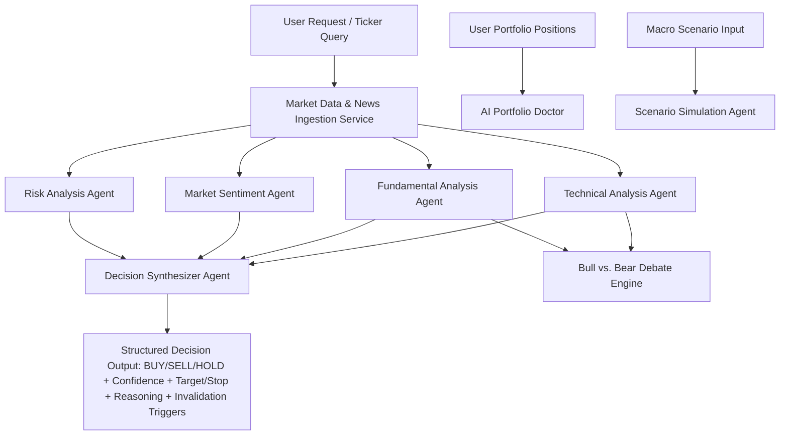

# MarketMind AI Architecture & Data Flow Documentation

MarketMind AI is designed as a **production-grade Autonomous Multi-Agent Investment Copilot**. Rather than relying on a single black-box prediction model, it operates like a professional equity research committee. Multiple independent, specialized AI agents evaluate the market from distinct quantitative and qualitative angles and pass their outputs to a **Decision Synthesizer Agent**.

---

## Multi-Agent AI System Architecture

---

## Agent Specifications & Typed Pydantic Schemas

### 1. Technical Analysis Agent (`agents/technical_agent.py`)
- **Inputs**: Ticker symbol (`str`), period (`str`).
- **Indicators Calculated**:
  - RSI (14-period)
  - MACD line, Signal line, Histogram
  - SMA 20, 50, 200 Golden Cross / Death Cross detection
  - Bollinger Bands (20, 2) Upper/Lower band breakouts
  - Support and Resistance levels (52-week rolling min/max)
- **Output Schema**: `TechnicalAnalysisOutput` (Score: 0–100, Trend, RSI, MACD signal, SMA cross, Support/Resistance levels, Summary reasoning).

### 2. Fundamental Analysis Agent (`agents/fundamental_agent.py`)
- **Inputs**: Ticker symbol (`str`).
- **Valuation & Quality Metrics**:
  - Trailing & Forward P/E Ratio
  - Price-to-Book (P/B) & EV/EBITDA
  - YoY Revenue Growth Rate (%)
  - Net Profit Margin (%) & Return on Equity (ROE %)
  - DCF Fair Value Estimate ($)
- **Output Schema**: `FundamentalAnalysisOutput` (Score: 0–100, Metrics breakdown, Valuation status: *Undervalued / Fairly Valued / Overvalued*, Summary reasoning).

### 3. Market Sentiment Agent (`agents/sentiment_agent.py`)
- **Inputs**: Ticker symbol (`str`).
- **Sentiment & NLP Analytics**:
  - News headline NLP sentiment classification (-1.0 to +1.0)
  - Social noise level (*Low / Medium / High*)
  - Macro Fear & Greed Index integration (0–100)
- **Output Schema**: `SentimentAnalysisOutput` (Score: 0–100, Sentiment label, Fear & Greed index, Top headlines, Summary reasoning).

### 4. Risk Analysis Agent (`agents/risk_agent.py`)
- **Inputs**: Ticker symbol (`str`).
- **Risk & Volatility Analytics**:
  - Annualized Volatility (%)
  - Beta vs. S&P 500 benchmark ($\beta$)
  - 1-Year Maximum Drawdown (%)
  - Macro interest rate sensitivity
- **Output Schema**: `RiskAnalysisOutput` (Score: 0–100 where 0=Safe and 100=Critical Risk, Risk level, Volatility, Beta, Max Drawdown, Summary reasoning).

### 5. Portfolio Doctor Agent (`agents/portfolio_agent.py`)
- **Inputs**: List of `PortfolioPosition` models.
- **Analytics**: Herfindahl-Hirschman Diversification Index, top sector concentration, expected annual return, portfolio beta.
- **Output Schema**: `PortfolioHealthOutput` (Health Score: 0–100, Diversification index, Sector concentration, Actionable suggestions).

### 6. Scenario Simulation Agent (`agents/scenario_agent.py`)
- **Inputs**: Natural language macro query (e.g. *"What if crude oil hits $100?"*).
- **Analytics**: Sector shock sensitivity matrix, vulnerable vs. benefiting tickers, estimated portfolio return impact (%).
- **Output Schema**: `ScenarioImpactOutput` (Title, Description, Impact %, Vulnerable tickers, Benefiting tickers, Strategic advice).

### 7. Bull vs. Bear Debate Agent (`agents/debate_agent.py`)
- **Inputs**: Ticker symbol (`str`).
- **Debate Personas**: Bull LLM persona, Bear LLM persona, Impartial Judge resolution.
- **Output Schema**: `BullBearDebateOutput` (Ticker, Bull case, Bear case, Judge verdict, Key catalysts, Key downside risks).

### 8. Decision Synthesizer Agent (`agents/decision_agent.py`)
- **Synthesis Weighting Formula**:
  $$\text{Overall AI Score} = 0.35 \times \text{Tech} + 0.35 \times \text{Fund} + 0.15 \times \text{Sent} + 0.15 \times (100 - \text{Risk})$$
- **Recommendation Thresholds**:
  - Score $\ge 68.0$: **BUY**
  - Score $\le 42.0$: **SELL**
  - $42.0 < \text{Score} < 68.0$: **HOLD**
- **Strict Decision Output Guarantee**: Ships with confidence %, entry range, target price, stop-loss limit, sub-agent score breakdown, plain-English narrative, thesis invalidation triggers, historical accuracy track record, and stated limitations.

---

## Data Layer & Resiliency Fallback Strategy

1. **Market Data Provider**: Uses `yfinance` as the primary free, real-time data source.
2. **API Keys**: Optionally reads `ALPHA_VANTAGE_API_KEY`, `POLYGON_API_KEY`, `OPENAI_API_KEY`, `GEMINI_API_KEY`, `ANTHROPIC_API_KEY` from `.env`.
3. **Deterministic Fallback**: If no external LLM API key is specified, the system switches to an advanced quantitative rule-based synthesizer. **The application never crashes or relies on mock placeholders.**

# 1. Start FastAPI Backend Service (Port 8000)
.\.venv\Scripts\python -m uvicorn backend.main:app --host 0.0.0.0 --port 8000 --reload

# 2. Start Next.js 15 Frontend Application (Port 3000)
cd frontend
npm run dev